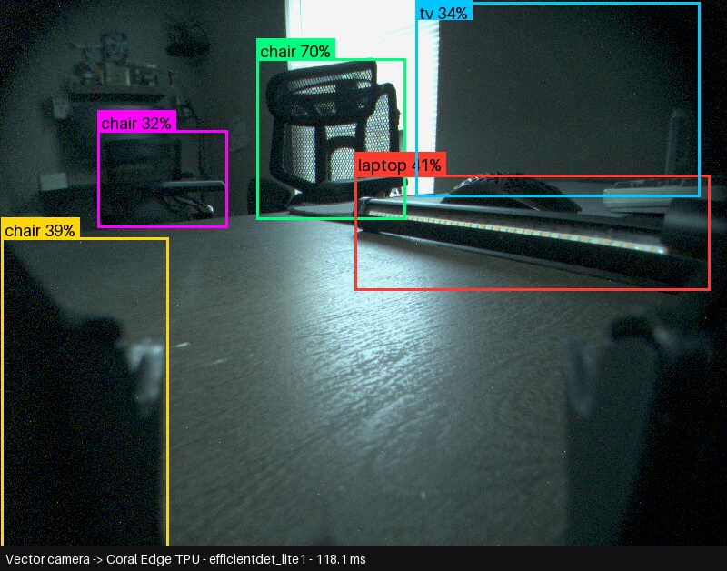
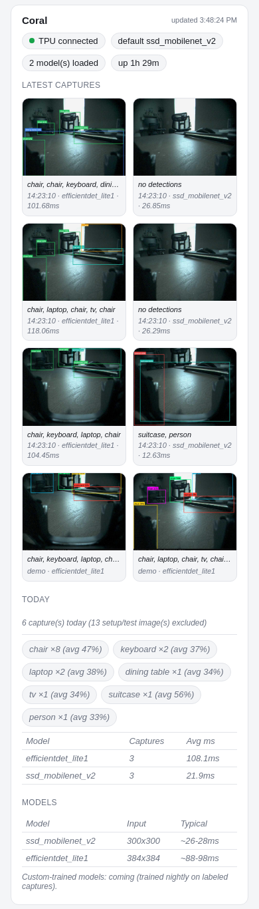

# vector-local-brain

A local, offline-first "brain" for the [Anki/Digital Dream Labs
Vector](https://www.anki.com/) desk robot — wake word → local LLM →
speech, entirely on your own hardware, with a Retrieval-Augmented Generation
(RAG) memory layer, an idle "curious" wandering/vision mode, a persistent
mood/diary system, optional Coral Edge TPU object detection, and an
optional escalation path to a bigger remote assistant when the local model
comes up short.

**Not affiliated with Anki, Digital Dream Labs, or the official Vector app
in any way.** This is a hobby project built on top of the excellent
open-source [wire-pod](https://github.com/kercre123/wire-pod) /
[WireOS](https://github.com/kercre123/wire-pod) project, which replaces
Vector's (now-defunct) cloud backend with a local one.

## What this actually is

Vector's official cloud backend has been shut down for years; wire-pod is
the community project that lets the robot keep working by pointing it at a
backend you run yourself. This repo is what we built **on top of** wire-pod:
a local LLM brain with memory, a wandering/curiosity mode, computer vision,
and a small fleet of support services — all running on hardware you own, no
cloud dependency required (aside from an optional escalation hook).

## Architecture

```
                    ┌─────────────────────┐
   wifi             │   Vector robot       │
◄──────────────────►│  (WireOS + camera)   │
                    └─────────┬────────────┘
                              │ wire-pod protocol (wake word, STT, intents)
                              ▼
   ┌──────────────────────────────────────────────────────────────┐
   │                         GPU host                              │
   │                                                                 │
   │  ┌────────────┐   /v1/chat/completions   ┌──────────────────┐ │
   │  │  wire-pod   │◄────────────────────────►│  brain-proxy      │ │
   │  │ (patched,   │   llm_first routing        │  (server.py)     │ │
   │  │  Go, Docker)│                             │  - RAG (rag.py)  │ │
   │  └─────┬──────┘                             │  - mood/diary    │ │
   │        │ STT: vosk                            │  - escalation ↗ │ │
   │        │                                       └────────┬────────┘ │
   │        │ /api-sdk/play_animation                        │          │
   │        │                                                 ▼          │
   │  ┌─────▼──────┐        ┌────────────┐       ┌──────────────────┐  │
   │  │  curious    │──────►│   Ollama    │◄──────│  Obsidian vault   │  │
   │  │ (wander +   │  LLM  │ (local LLM  │  RAG  │  (persistent      │  │
   │  │  vision loop)│ calls│  + vision)  │ reads │   memory/notes)   │  │
   │  └─────┬──────┘        └────────────┘       └──────────────────┘  │
   │        │ object detection                                          │
   │        ▼                                                            │
   │  ┌────────────┐        ┌────────────────┐                          │
   │  │ Coral       │        │  Dashboard      │                        │
   │  │ Edge TPU    │        │  (read-only     │                        │
   │  │ service     │        │   web UI)       │                        │
   │  └────────────┘        └────────────────┘                          │
   └──────────────────────────────────────────────────────────────┘
                              │ (optional, off by default)
                              ▼
                  ┌───────────────────────────┐
                  │  Remote escalation         │
                  │  assistant (any HTTP LLM   │
                  │  endpoint you point it at) │
                  └───────────────────────────┘
```

## Components

| Dir | What it is |
|---|---|
| `wire-pod-patches/` | A `git format-patch` series against upstream wire-pod (conversation mode, kill phrase, classifier, speech pace, …), plus example `apiConfig.json` / `customIntents.json` and the build/deploy script |
| `brain-proxy/` | The LLM proxy wire-pod talks to: injects RAG context from an Obsidian-style vault, tracks a lightweight mood/battery state, keeps same-day conversational memory, and optionally escalates unanswerable questions to a remote assistant |
| `curious/` | An idle-time "wander and be curious" mode: periodically takes a snapshot, describes what it sees, asks a short spoken question about it, and folds the answer into memory |
| `coral/` | A small Flask/Docker service wrapping a Google Coral USB Edge TPU for fast local object detection, used by `curious/` (incl. Proxmox LXC passthrough notes) |
| `faces/` | Local household face recognition (OpenCV YuNet + SFace, CPU only, localhost only) with an enrollment CLI that uses the robot's own camera |
| `music/` | "Play a song" / dance-party custom intents for wire-pod (yt-dlp → Vector's speaker, BPM-paced stock dance clips) and a watcher that stops the music when you start talking |
| `ollama/` | Modelfile tweaks (full GPU offload, explicit context), keep-alive settings and a reboot warm-up cron |
| `dashboard/` | A read-only web dashboard showing recent conversations, curious-mode activity, and mood/battery state |
| `health/` | A one-line-per-run stability probe (ping + a couple of HTTP checks) for cron |
| `transcribe/` | Optional: a standalone `faster-whisper` CLI wrapper for transcribing arbitrary audio/video, independent of the robot pipeline |
| `log-receiver/` | A tiny UDP syslog-style listener so you can forward the robot's own logs off-device |
| `docs/robot-tweaks.md` | Small robot-side (WireOS) edits and findings that don't belong in this repo as files |

## Features

- **Local-first**: wake word → STT → LLM → TTS all run on your own
  hardware via wire-pod + Ollama. No cloud dependency for normal operation.
- **`llm_first` routing**: voice goes to the LLM first, wire-pod's built-in
  intent graph is the fallback (patched into wire-pod — see
  `wire-pod-patches/`).
- **RAG memory**: a scoped, auditable retrieval layer over a small
  Obsidian-style markdown vault, with an always-on always-included slice
  plus similarity-ranked retrieval for the rest.
- **Mood + same-day memory**: the brain proxy tracks lightweight
  mood/battery state and recent same-day conversation turns so replies have
  continuity across a session.
- **Curious/wander mode**: during idle time, the robot looks around, asks
  about what it sees, and (optionally) drives home to charge — all
  config-driven (quiet hours, gap timing, battery thresholds, etc. — see
  `curious/config.example.json`).
- **Coral Edge TPU vision**: sub-30ms local object detection, used to give
  curious mode something specific to ask about.
- **Escalation hook**: optional, rate-limited fallback to a bigger remote
  LLM assistant when the local model can't answer — fails open to the local
  model's own answer on any error/timeout.
- **Stability tooling**: a health probe, a log receiver, and a
  build/deploy script with a last-known-good rollback image.

## Changelog

### 2026-10-15

- **Conversation mode, properly**: up to 100 back-and-forth turns without
  repeating the wake word (was 6), and the follow-up timeout now counts
  silence after Vector finishes speaking instead of the whole round trip
  including TTS (long answers used to eat the listening window).
- **Kill phrase**: "end conversation", "that's all, Vector", "goodbye Vector"
  end conversation mode immediately with a short goodbye and no LLM call.
  Fuzzy matching tolerates Vosk hearing "end" as "in"/"and", word order and a
  trailing "stop", and it is checked before every other matcher.
- **Speech pace**: `knowledge.speech_duration_scalar` (default 1.05) makes
  Vector talk ~10% slower and clearer.
- **Forced vision**: questions like "what do you see / what is this / read
  this" always trigger a real `{{getImage}}` capture instead of answering from
  memory. Only the latest user message decides routing, images are attached to
  the latest message only, older images are stripped from history, and a loop
  guard stops repeated capture requests. Vision prompt rewritten to describe
  only what's actually in frame (no invented objects, correct perspective).
- **Brightening**: `brain-proxy/brighten.py` auto-corrects Vector's dim,
  green-tinted camera frames (gain + black level + white balance, numpy/Pillow,
  fail-open) before they reach the vision model, the Coral and the face DB.
- **Face DB** (`faces/`): local household face recognition; the brain proxy
  injects "People you can currently see: …" and curious mode greets enrolled
  people by name. Strictly local; face data is git-ignored.
- **Hourly idle explorer** (`curious/`): at most once an hour, only after
  30 min without conversation, in waking hours, with decent battery, no music
  and sentry off, Vector drives off the dock for ~4 min, looks around and
  mutters to himself about what he sees (no questions, no mic), saves at most
  a couple of notes, then returns to the charger. Desk safety: cliff checks,
  back-off at edges, stop after 2 cliff events, a 30 cm leash, and any voice
  stops the wheels. Only occasionally (~1 in 5, and only if someone is home)
  does a session end with a question. A trigger file allows "explore now".
- **Greet on sight**: while exploring, recognised faces (via `faces/`) make
  Vector stop, turn toward the person, look up, greet them by name with a
  getting-to-know-you question and hand over to conversation mode;
  30 min cooldown per person, no greeting for strangers.
- **Per-person notes**: one markdown note per enrolled person in the vault
  (`20-agents/vector/people/<slug>.md`: who they are, things learned,
  questions already asked). Answers are distilled into that note (with a
  sensitive-info filter and kid-safe topics for people marked `kid: true`),
  topics rotate so questions don't repeat, and the brain proxy injects a short
  summary of the note for whoever is in view. Those turns are never sent to
  the remote escalation assistant with a local draft.
- **Trailing-question stripper**: drops the reflexive "Anything else?"-style
  question at the end of replies (conversation mode already keeps listening).
- **Dance**: "dance party" / "dance to the music" plays an upbeat track and
  dances with Vector's own stock dance clips, paced by a numpy-only BPM
  estimate; all robot motion goes through a shared robot-control lock.
- **Music stop-on-wake**: a host-side watcher stops playback the moment a new
  voice capture starts, so you can talk to Vector over the music.
- **Ollama**: full GPU offload (`num_gpu 99`) and explicit context for the chat
  and vision models, keep-alive forever, and a staggered reboot warm-up.

## Screenshots

### Coral vision on a real Vector frame
First real frame from Vector's camera through the Coral Edge TPU (`efficientdet_lite1`, ~118 ms). It gets the office chair right at 70% and, adorably, tags Vector's own lift arm as a "chair".



### Dashboard: Coral section
The `dashboard/` web app (mobile-friendly) showing Coral Edge TPU status, the latest robot captures with detection boxes drawn on, today's per-label tally, and per-model latency.



## Hardware used

- A GPU host running Docker: 2× 16GB-class GPUs (one for the always-on
  local LLM via Ollama, kept warm; the other with headroom for occasional
  GPU-accelerated transcription), enough RAM to run wire-pod + brain-proxy +
  curious + Ollama concurrently.
- A Google Coral USB Accelerator (Edge TPU) for object detection.
- A Vector robot (any WireOS-compatible unit) on the same LAN.
- Everything is otherwise commodity: no special networking, no cloud
  compute required.

## Setup

1. **wire-pod**: follow [wire-pod's own setup docs](https://github.com/kercre123/wire-pod)
   to get your robot escaped and talking to a wire-pod instance you control.
   Then apply our patches — see `wire-pod-patches/README.md`.
2. **Ollama**: install and pull the models referenced in
   `wire-pod-patches/apiConfig.example.json` / `curious/config.example.json`
   (an instruct model for chat, a small vision model, an embedding model
   for RAG).
3. **brain-proxy**: copy `brain-proxy/.env.example`, fill in placeholders,
   point wire-pod's `apiConfig.json` `knowledge.endpoint` at brain-proxy
   instead of Ollama directly (brain-proxy proxies to Ollama and injects
   RAG context). Run with `start.sh` / `stop.sh` / `watchdog.sh`.
4. **A markdown vault** for RAG: any folder of `.md` notes works; point
   `VECTOR_VAULT_ROOT` at it. Start empty — it grows as you use it.
5. **curious/** (optional): copy `config.example.json` → `config.json`,
   fill in your robot's ESN, build/run the Docker container.
6. **coral/** (optional, needed for curious mode's object descriptions):
   install the udev rule (`coral/udev/`), download the two EdgeTPU models
   from the [`google-coral/test_data`](https://github.com/google-coral/test_data)
   repo into `coral/models/` (not included in this repo — see
   `coral/README.md` for exact filenames), build/run.
7. **dashboard/, health/, log-receiver/, transcribe/**: all optional,
   independently useful, see each directory.

## Robot-side tweaks

A handful of small edits live on the robot itself (WireOS), not in this
repo — journald disk cap, a `user_intent_map.json` typo fix, syslog
forwarding, a `/etc/hosts` pin, and a couple of debugging findings (a
low-memory overlay, a connect-storm fault, and an intent-routing gotcha).
See **`docs/robot-tweaks.md`**.

## Credits

- [wire-pod](https://github.com/kercre123/wire-pod) by
  [kercre123](https://github.com/kercre123) and contributors — the
  local-backend project that makes any of this possible. MIT licensed.
- [WireOS](https://github.com/kercre123/wire-pod) — the companion
  robot-side firmware.
- The [`anki_vector` Python SDK](https://github.com/digital-dream-labs/vector-python-sdk) —
  Apache-2.0 licensed, used client-side for the utility scripts under
  `curious/`.
- [Google Coral](https://coral.ai/) / `pycoral` / `tflite-runtime` for the
  Edge TPU vision service.
- [OpenCV Zoo](https://github.com/opencv/opencv_zoo) — YuNet (MIT) and SFace
  (Apache-2.0) face models used by `faces/` (downloaded, not redistributed).
- [`wirepod_vector_sdk`](https://github.com/kercre123/wirepod-vector-python-sdk)
  (Apache-2.0), [yt-dlp](https://github.com/yt-dlp/yt-dlp) (Unlicense) and
  [ytmusicapi](https://github.com/sigma67/ytmusicapi) (MIT) — runtime
  dependencies of `music/` and `faces/`, installed via pip, not vendored.

## License

MIT — see `LICENSE`. `wire-pod-patches/` is a patch series against wire-pod
(MIT, © 2022 Kerigan Creighton), whose `chipper/` is derived from Digital
Dream Labs' chipper (MIT, © 2021 Digital Dream Labs). See
`THIRD_PARTY_NOTICES.md` and `wire-pod-patches/README.md`.
